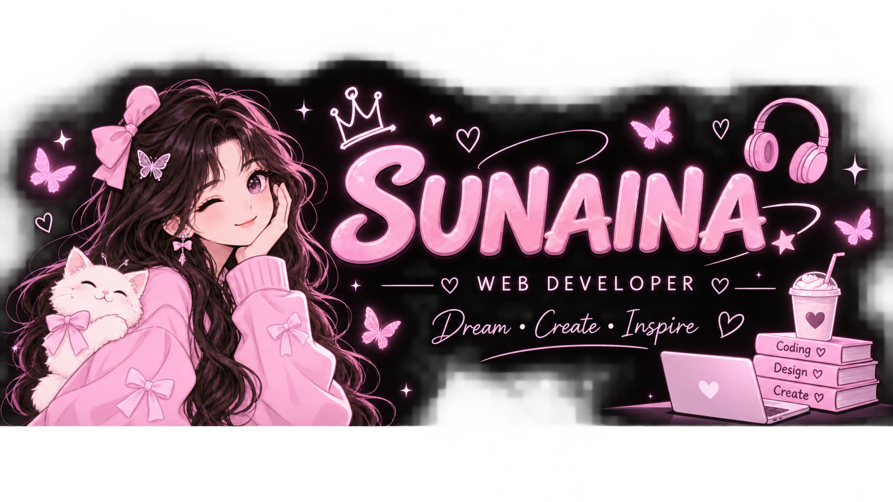
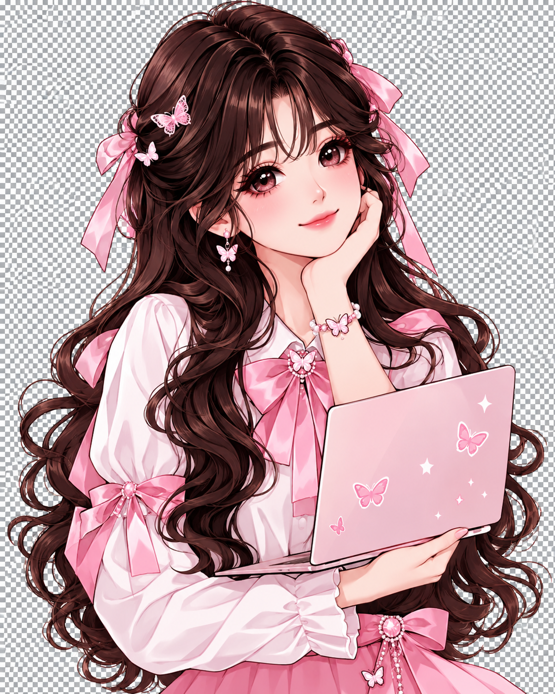

◯ ━━━━━━━━━━━ ◎ ━━━━━━━━━━━ ◯

### ✧ WELCOME TO MY CREATIVE WORLD ✧

*Turning imagination into interactive digital experiences.*

---

## ♡ ABOUT ME ♡
*The person behind the pixels*

<table>
<tr>
<td width="65%" valign="middle">

### 🌸 Hello, I'm Sunaina!

I'm a creative web developer who loves building beautiful, responsive and interactive websites.

I enjoy combining design, technology and creativity to turn ideas into real digital experiences.

**♡ WHAT I LOVE**

- 🎨 Creative UI and web design
- 💻 Frontend development
- ✨ Smooth animations and interactions
- 🌐 Responsive website development
- 🚀 Learning new technologies

**♡ MY MINDSET**

Always curious. Always creating. Always improving.

</td>
<td width="35%" align="center">

### SUNAINA
CREATIVE WEB DEVELOPER

🌷 Dream • Create • Inspire

</td>
</tr>
</table>

---

## ✨ MY CREATIVE PERSONALITY ✨

<table>
<tr>
<td align="center" width="33%">

### 🎀 CREATIVE

Imagining beautiful designs and unique ideas.

</td>
<td align="center" width="33%">

### 💻 DEVELOPER

Building useful experiences with code.

</td>
<td align="center" width="33%">

### 🚀 DREAMER

Learning, growing and exploring new possibilities.

</td>
</tr>
</table>

---

## ♡ MY TECH STACK ♡

*The tools behind my creations*

<table>
<tr>
<td align="center" width="50%">

### 🌸 FRONTEND DEVELOPMENT

</td>
<td align="center" width="50%">

### 🌷 BACKEND DEVELOPMENT

</td>
</tr>
<tr>
<td align="center" colspan="2">

### 🎀 TOOLS & WORKFLOW

</td>
</tr>
</table>

---

## 💗 SKILLS IN MOTION 💗

---

## ✧ MY CREATIVE PROJECTS ✧

*Ideas brought to life*

<table>
<tr>
<td colspan="2" align="center">

# 🍽️ BITEORA

### Exceptional Food, Beautifully Served

</td>
</tr>
<tr>
<td width="60%" valign="top">

### ♡ ABOUT BITEORA

A restaurant and food-ordering website with a PHP and MySQL backend.

**FEATURES**

- Food menu and product categories
- Product details
- Shopping cart
- Checkout and order placement
- Login and registration
- Admin dashboard
- Responsive design

**TECHNOLOGIES**

HTML · CSS · JavaScript · PHP · MySQL

</td>
<td width="40%" align="center" valign="middle">

**FOOD**

**DESIGN**

**TECHNOLOGY**

</td>
</tr>
</table>

---

## 🌷 MY GITHUB WORLD 🌷

*Every contribution is a step forward.*

<table>
<tr>
<td width="50%" align="center">

### ✧ PROFILE STATISTICS

</td>
<td width="50%" align="center">

### ✧ TOP LANGUAGES

</td>
</tr>
<tr>
<td colspan="2" align="center">

### ♡ CONTRIBUTION STREAK ♡

</td>
</tr>
</table>

---

## ✨ MY CONTRIBUTION JOURNEY ✨

---

## ♡ LET'S CONNECT ♡

*Have an idea? Let's create something amazing together!*

<table>
<tr>
<td align="center" width="33%">

### GITHUB

<a href="https://github.com/Sunaina-hue">VISIT PROFILE ↗</a>

</td>
<td align="center" width="33%">

### LINKEDIN

<a href="YOUR_LINKEDIN_URL">CONNECT ↗</a>

</td>
<td align="center" width="33%">

### EMAIL

<a href="mailto:YOUR_EMAIL">SAY HELLO ↗</a>

</td>
</tr>
</table>

---

### 🌸 THANK YOU FOR VISITING MY PROFILE 🌸

*Keep dreaming. Keep creating. Keep coding.*

**SUNAINA ♡**

